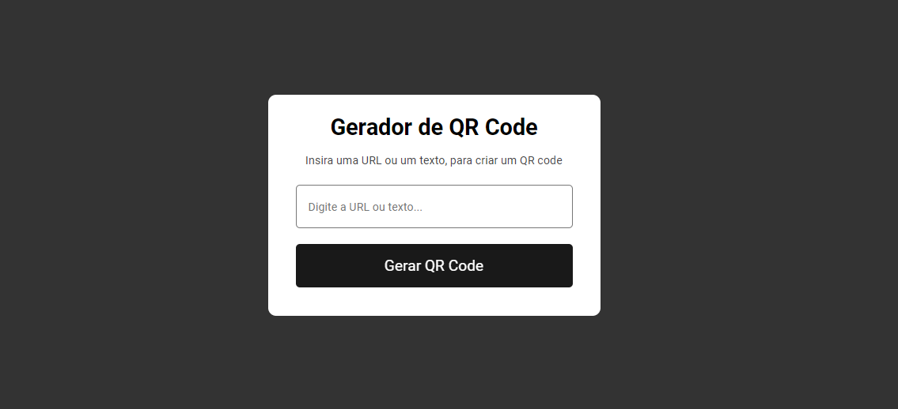

# 📱 QR Code Generator

Um projeto simples e funcional de **gerador de QR Codes** desenvolvido com **HTML, CSS e JavaScript**.  
A aplicação permite que o usuário insira um texto ou URL e, com apenas um clique, gere o QR Code correspondente utilizando uma API externa.

> ℹ️ Este projeto é um **clone** do repositório original: [joaolira-dev/qrcode-generator](https://github.com/joaolira-dev/qrcode-generator.git)

---

## 🚀 Funcionalidades
- Geração de QR Code a partir de **texto ou URL**
- Interface **intuitiva e fácil de usar**
- Layout **responsivo**, adaptado para diferentes tamanhos de tela

---

## 🛠️ Tecnologias Utilizadas
- **HTML5** → Estruturação do conteúdo da página  
- **CSS3** → Estilização da interface com design simples e responsivo  
- **JavaScript** → Manipulação de dados e integração com a API  
- **API de QR Code** → Geração dinâmica dos códigos

---

## 🔗 Demonstração
Teste a aplicação diretamente pelo link:  
👉 [Clique aqui para experimentar](https://allansacramento.github.io/qrcode-generator/)

---

## 🔧 Instalação

1. Clone este repositório:
   ```bash
   git clone https://github.com/allansacramento/qrcode-generator.git```

2. Navegue até a pasta do projeto

    ```bash
    cd qr-code-generator
    ```

3. Abra o arquivo index.html no seu computador

---
## 📋 Como Usar
1. Insira o texto ou a URL que deseja converter em QR Code.
2. Clique no botão "Gerar QR Code".
3. O QR Code será exibido na tela.<br/><br/>





